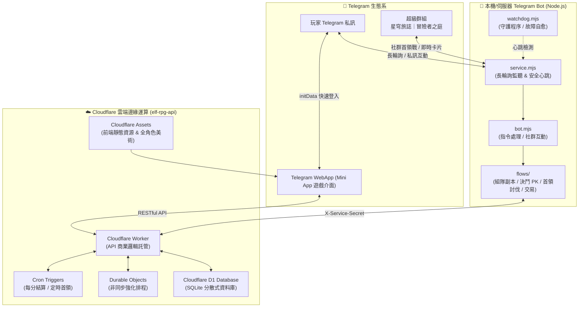

# 星穹旅誌 ✨ (Star Journal RPG)

> 一款深度整合 **Telegram 超級群組社群** 與 **Cloudflare Serverless 邊緣架構** 的現代化沉浸式 RPG 服務。

---

## 🏛️ 系統全景架構



---

## 📂 專案目錄結構

```
star-journal-rpg/
├── bot/                     # Telegram 機器人服務（Node.js 長輪詢）
│   ├── service.mjs          # 機器人啟動入口與服務管理
│   ├── bot.mjs              # 訊息分發、群組指令、權限過濾
│   ├── watchdog.mjs         # 看門狗進程（保證服務 7x24 不中斷）
│   ├── game-fetch.mjs       # 安全 API 傳輸底層
│   ├── flows/               # 核心 RPG 互動流程
│   │   ├── rpg-flow.js      # RPG 核心卡片與互動選單
│   │   ├── rpg-party-flow.js# 三人組隊討伐試煉
│   │   ├── rpg-pk-animation-flow.js # 決鬥對決動畫
│   │   └── rpg-boss-card.js # 群組首領卡片生成
│   ├── assets/              # 群組歡迎圖、按鈕視覺素材
│   ├── telegram.local.example.json # Telegram 連線設定範本
│   └── rpg.local.example.json      # Worker API 連線設定範本
│
├── worker/                  # Cloudflare Worker 遊戲後端與 Mini App
│   ├── src/                 # 後端核心邏輯
│   │   ├── index.js         # API 路由主入口
│   │   ├── game/            # 戰鬥、職業分支、裝備、鍛造、商城
│   │   └── services/        # 玩家數據存取與業務邏輯
│   ├── public/              # Telegram Mini App 前端網頁（含全角色外觀圖鑑與戰鬥動畫）
│   ├── migrations/          # Cloudflare D1 (SQLite) 結構遷移腳本
│   └── wrangler.toml.example# Cloudflare Worker 設定範本
│
├── docs/                    # 完整架構與配置說明
│   └── SETUP_GUIDE.md       # 詳細建置與環境設定教學
│
├── push-to-github.cmd       # Windows 一鍵推送至 GitHub 工具
├── .gitignore               # 嚴格過濾機密金鑰、本地環境檔與日誌
└── README.md                # 專案首頁說明
```

---

## 🚀 快速上手 (Quick Start)

### 1. Telegram Bot 本機啟動
1. 進入 `bot/` 目錄。
2. 複製設定檔：
   - `copy telegram.local.example.json telegram.local.json`
   - `copy rpg.local.example.json rpg.local.json`
3. 填入您的 Telegram Bot Token 與群組 ID。
4. 執行 `node service.mjs` 或雙擊 `watchdog.mjs` 啟動。

### 2. Cloudflare Worker 部署
1. 進入 `worker/` 目錄。
2. 複製設定檔：`copy wrangler.toml.example wrangler.toml`。
3. 填入您的 Cloudflare `account_id` 與 D1 `database_id`。
4. 部署資料庫：`npx wrangler d1 migrations apply elf-rpg --remote`。
5. 部署 Worker：`npx wrangler deploy`。

---

## 🛡️ 資安與隱私防護

- **零金鑰外洩**：所有敏感性設定檔（包含 `*.local.json`、`.env`）已全數由 `.gitignore` 隔離保護。
- **無狀態認證**：Telegram Mini App 採用標準 Telegram `initData` HMAC-SHA256 密碼學校驗。
- **後端鑑權**：Bot 與 Worker 之間採用專屬 `X-Service-Secret` 雙向簽章，確保外部無法直接偽造首領攻擊或玩家獎勵發放。
