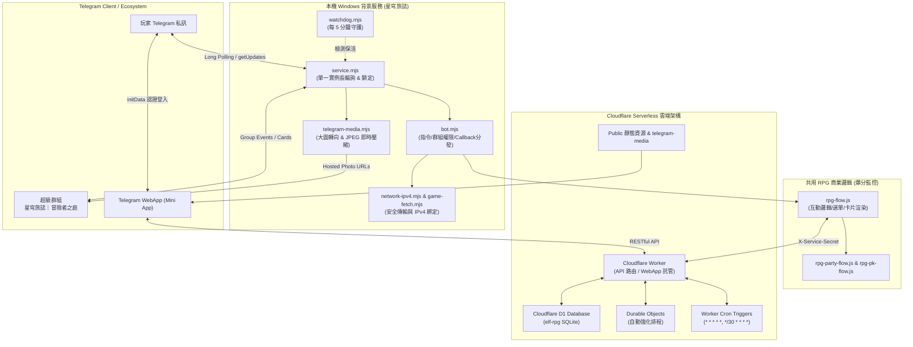

# 星穹旅誌 ✨ (Star Journal RPG Bot)

[](https://nodejs.org/)
[](https://core.telegram.org/bots/api)
[](https://workers.cloudflare.com/)
[](#)

《**星穹旅誌**》是一款深度整合 Telegram 專屬超級群組與 Cloudflare Worker 雲端架構的沉浸式 RPG 機器人服務。支援 Telegram WebApp (Mini App)、自動掛機打怪、裝備鍛造與強化、首領即時討伐、多人組隊副本、星穹爬塔、玩家決鬥 (PK) 以及每日旅團日誌委託系統。

---

## 🏛️ 系統架構全景



---

## 📁 專案模組與目錄結構

```
星穹旅誌/
├── .gitignore                   # 排除機密設定、執行期狀態與記錄
├── package.json                 # 專案資訊與 NPM 腳本
├── README.md                    # 本文件（GitHub 規格說明）
├── AI_HANDOVER.md               # 專供 AI 代理接手之詳細手冊與操作邊界
├── MIGRATION_HANDOFF.md         # 2026-10-12 切換驗證與正式交接歷史
├── AGENTS.md                    # 工作視窗指引與協作協議
├── telegram.local.json.example  # Telegram 設定範本（無機密）
├── rpg.local.json.example       # 後端 API 設定範本（無機密）
│
├── service.mjs                  # 主服務進程（start / stop / status / run）
├── bot.mjs                      # BOT 指令、群組驗證與分發
├── watchdog.mjs                 # 背景自動重啟守護進程
├── launch-watchdog.vbs          # Windows 無視窗背景啟動腳本
├── game-fetch.mjs               # 具備連線池、壓縮解碼與防重放的安全 HTTP 模組
├── network-ipv4.mjs             # 系統本機 DNS 查詢攔截（強制 IPv4）
├── telegram-media.mjs           # 圖片優化層（自動轉向公開網址與動態壓圖）
├── publish-telegram-art.mjs     # 首領與歡迎圖壓制並同步至 Worker
├── post-welcome.mjs             # 發送群組置頂歡迎卡片工具
├── post-relocation.mjs          # 舊小精靈群組搬遷公告通知腳本
├── fix-boss-card.mjs            # 首領戰況卡片修正與重複清理腳本
├── verify-backup.mjs            # 備份資料完整性離線 SQLite 檢測腳本
│
├── art-work/                    # 角色、各階轉職之影格與 QA 紀錄
│   └── sword-adv4-20261012/     # 劍士四轉素材與戰鬥畫格審閱
├── assets/                      # BOT 頭像、群組頭像與歡迎底圖原檔
├── test/                        # 自動化單元測試
│   ├── game-fetch.test.mjs      # 原生安全 HTTP 傳輸與異常處理測試
│   ├── isolation.test.mjs       # 準備模式（Staged）與隔離性測試
│   └── media.test.mjs           # 圖片壓縮演算法與網址路由改寫測試
├── tools/                       # 角色立繪、影格生成、打包與自動化 QA 工具
│   ├── build-sword3-release.mjs
│   ├── build-sword4-release.mjs
│   ├── pack-sword-adv3.mjs
│   ├── pack-sword-adv4.mjs
│   └── qa-sword4-battle.mjs
├── state/                       # 執行期狀態（.gitignore，本機產生）
└── logs/                        # 服務運作記錄（.gitignore，本機產生）
```

---

## 🚀 核心特色與功能說明

### 1. Telegram 深度整合與 Mini App
- **私訊與選單按鈕**：私訊預設配置 `開啟旅誌` 專屬 WebApp 快捷選單，一鍵直達遊戲世界。
- **身分驗證體系**：遊戲前端全面使用 Telegram WebApp `initData` 簽名由 Worker 後端校驗，免去手動輸入密碼。
- **專屬群組門檻**：非群組成員在私訊觸發 `/rpg` 時，會自動引導加入專屬超級群組《冒險者之庭》。

### 2. 每日旅團日誌系統（2026-10-13 最新實裝）
- 每日台北時間 `00:00` 重置任務，提供 6 項互動型冒險委託，可自選 3 項完成。
- **群組報到卡**：每日 `08:00` 由定時程序向群組自動送出當日共用精美照片卡。
- **強化捲獎勵**：完成委託可領取對應個人裝備階級 $T$ 的強化捲；完成三項並參與合作戰鬥，額外獲得同行贈禮（每日最高 $4T$）。

### 3. 多人協作與即時戰況廣播
- **整點首領討伐**：每日 08:00～24:00 每整點降臨群組首領，群組內直接點擊攻擊按鈕參戰。
- **組隊打寶與爬塔**：支援 3 人即時組隊挑戰地下城，手動戰術即時觸發與戰果結算。
- **裝備分享與交易**：支援長按裝備一鍵分享至群組，群內玩家可按讚或發起安全交易。

---

## 🛠️ 安裝與本機運作指南

### 1. 環境需求
- **Node.js**：`>= 20.0.0`
- **作業系統**：Windows / Linux / macOS（目前生產節點運行於 Windows）

### 2. 設定檔配置
複製設定範本並填入必要金鑰：

```bash
cp telegram.local.json.example telegram.local.json
cp rpg.local.json.example rpg.local.json
```

**`telegram.local.json` 說明**：
```json
{
  "botToken": "<YOUR_TELEGRAM_BOT_TOKEN>",
  "chatId": "-1004342516953",
  "botUsername": "StarJournalRpgBot",
  "active": true,
  "inviteLink": "https://t.me/+5hDQa1rrBv4xMDhl",
  "appUrl": "https://elf-rpg-api.micisachen.workers.dev/",
  "rpgConfigFile": "./rpg.local.json"
}
```

**`rpg.local.json` 說明**：
```json
{
  "apiUrl": "https://elf-rpg-api.micisachen.workers.dev",
  "serviceSecret": "<YOUR_WORKER_SERVICE_SECRET>",
  "appUrl": "https://elf-rpg-api.micisachen.workers.dev/",
  "mainMiniApp": false,
  "enabled": true
}
```

### 3. 服務啟動與控制

```bash
# 啟動背景服務（會自動載入 IPv4 優先與 Windows 隱藏視窗）
node service.mjs start

# 查看服務即時狀態與心跳
node service.mjs status

# 優雅停止服務（會清除 lock 並寫入 stop-request）
node service.mjs stop
```

---

## 🧪 測試與品質驗收

本專案自帶完整的本機測試套件，涵蓋 HTTP 通訊、準備模式隔離性以及媒體壓縮等關鍵路徑：

```bash
node --test test/game-fetch.test.mjs test/isolation.test.mjs test/media.test.mjs
```

**預期測試涵蓋**：
- ✔ 原生傳輸只發送一次 UTF-8 JSON POST 並正確解析標準 Response
- ✔ Multipart 圖片與 GIF 封包保持位元邊界
- ✔ 連線錯誤僅重試安全 GET，**絕不重試 POST 變更請求**
- ✔ 準備模式（`active: false`）絕對不呼叫後端 API，亦不產生正式戰鬥
- ✔ 首領大圖維持尺寸並大幅壓縮以符合 Telegram 傳輸規範

---

## 🔒 資安與營運守則

1. **機密檔案保護**：`*.local.json`、`state/`、`logs/` 與 `backup/` 已列入 `.gitignore`，嚴禁提交或公開於任何公開 Repository。
2. **單一輪詢程序原則**：Telegram Bot API 的 `getUpdates` 嚴禁有多個程序同時搶佔，避免 Update 丟失或 Callback 響應異常。
3. **資料庫防護**：本專案與正式營運之 D1 資料庫直接連結，禁止執行全表清除、重建或覆蓋操作。
